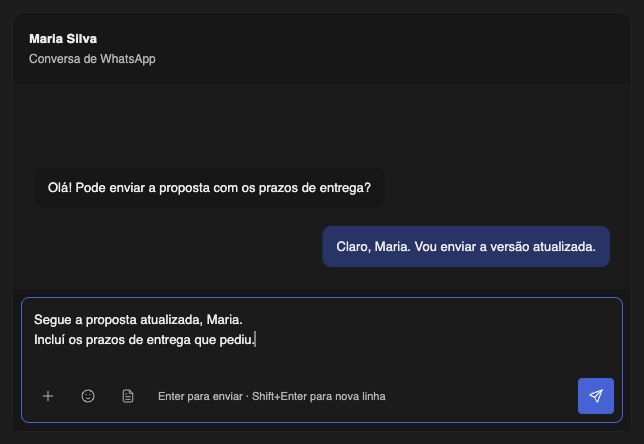

# Chat composer refinement — 2026-11-03

The message box now spans the composer width above its toolbar. It starts with room for three lines and grows within a bounded height. Attachments, emoji and template selection are compact icons on the left; Send stays separate on the right. Icons retain translated accessible labels and inline tooltips, with keyboard focus and Escape dismissal. The keyboard shortcut hint hides visually in narrow panes while remaining available to assistive technology. A character count appears near the message limit.

The Send icon uses white against the blue action background in both themes; the theme's inverted foreground was too dark in dark mode. Existing send guards, IME handling, draft retention and permissions remain in place.

Validation: lint and typecheck passed; all 24 existing UI regressions passed; Twenty 2.54 app build passed; whitespace checks passed. A local Chromium preview rendered the actual Composer and shared styles with Twenty's theme and mocked host callbacks. It verified Portuguese copy, keyboard tooltips and Escape, a 320px conversation pane with no horizontal overflow, full-width input, and long-draft growth capped at 144px with the toolbar visible. This preview did not send messages or deploy the app.

