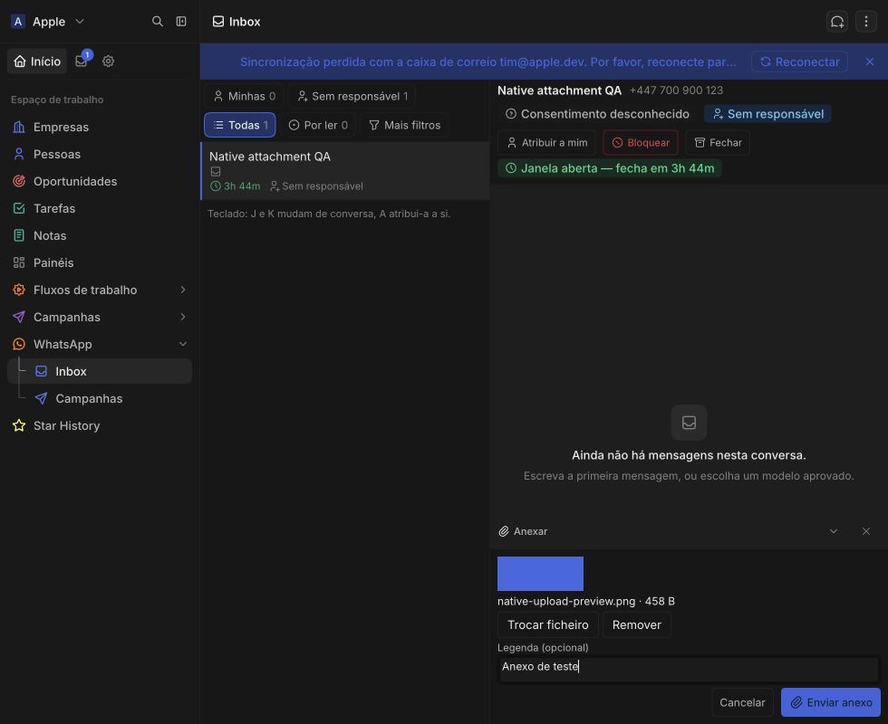

# Native upload implementation QA — 2026-11-03

Validated against an isolated `twentycrm/twenty:v2.54.0` instance at `localhost:2021`, using SDKs and CLI 2.54.0. No production deployment, publication or WhatsApp delivery was performed.

## Automated checks

- Lint and typecheck, including the client generated from the installed 2.54 workspace.
- 83 unit test files, 1,867 passing tests. Coverage includes upload validation/failure/retry, stale-result generations, trusted caller identity, Agent authorization, protected record permissions, queue attachment before scheduling, campaign mapping associations and legacy handles.
- 4 integration test files, 40 passing tests. Actual binary uploads are retained on message and campaign FILES fields, survive rereads, download through fresh signed URLs, copy independently for reuse, and resolve campaign files through queued delivery associations. Campaign replacement and removal are exercised.
- `yarn twenty app build --no-input --json` succeeds. Integration setup applies the app with the standalone 2.54 CLI and uninstalls it afterward.

## Sandboxed Chromium checks

Tested in Microsoft Edge with the installed app, through real trusted button clicks and the native file chooser:

- Ordinary image upload, preview, filename/size, upload indicator, and Send disabled until success.
- Same-file replacement, removal, empty-file rejection and oversized-image rejection. The caption survives replacement, removal and validation errors.
- English and Portuguese controls; keyboard Enter opens the native chooser.
- A 439-pixel-wide conversation widget keeps its preview, caption and Send action visible. Panel height and scroll height both measured 193 pixels.
- Template image-header upload enables Send after success, without a URL input.
- Campaign image-header upload saves a matching file ID and canonical path together with the FILES association. Reloading and continuing the draft restores the preview and filename.
- Dismissing a replacement chooser leaves the selected file intact. Cancelling or navigating away discards the UI result; it does not claim to abort the underlying host transfer.

## Remaining release checks

- Browser testing used the disposable workspace administrator. The ordinary Agent gate and role permissions are covered automatically; repeat the browser flow with an actual Agent member before release.
- Exercise physical microphone capture and playback. Voice notes use the same validated upload adapter and retain the file before enabling Send.
- Confirm WhatsApp delivery with an explicitly approved test recipient and configured Meta credentials. None were supplied for this run.

The QA account, thread, template and unlaunched campaign were removed from the disposable workspace before the final integration run. The disposable container and temporary QA credentials were removed after validation. Production upgrades, deployment and publication remain separate rollout actions.
