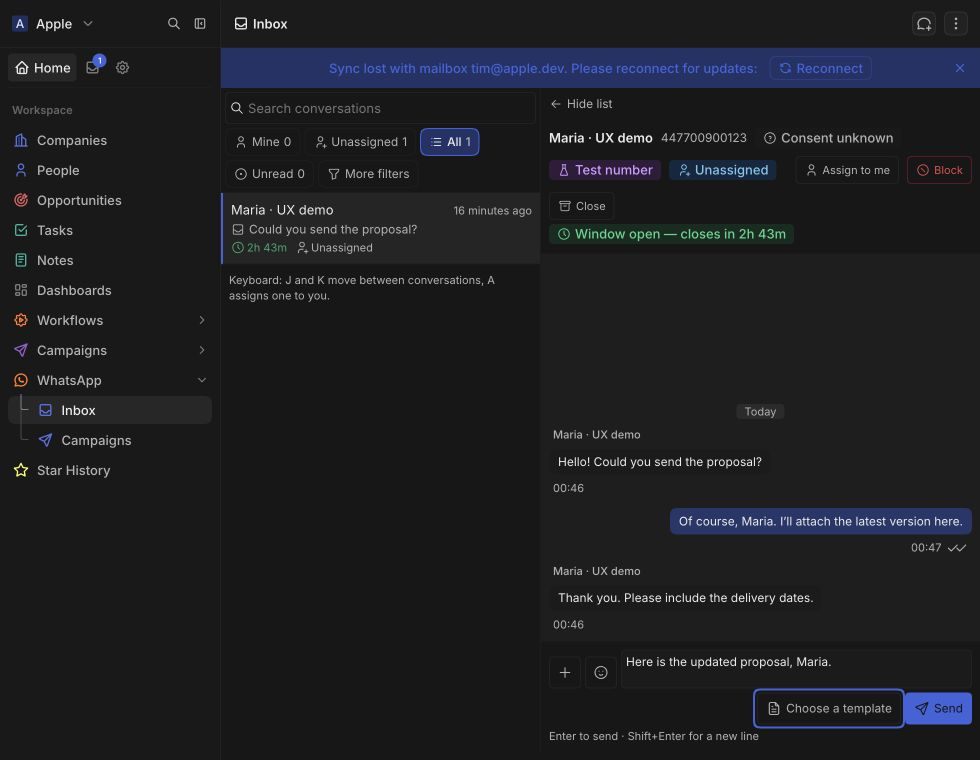
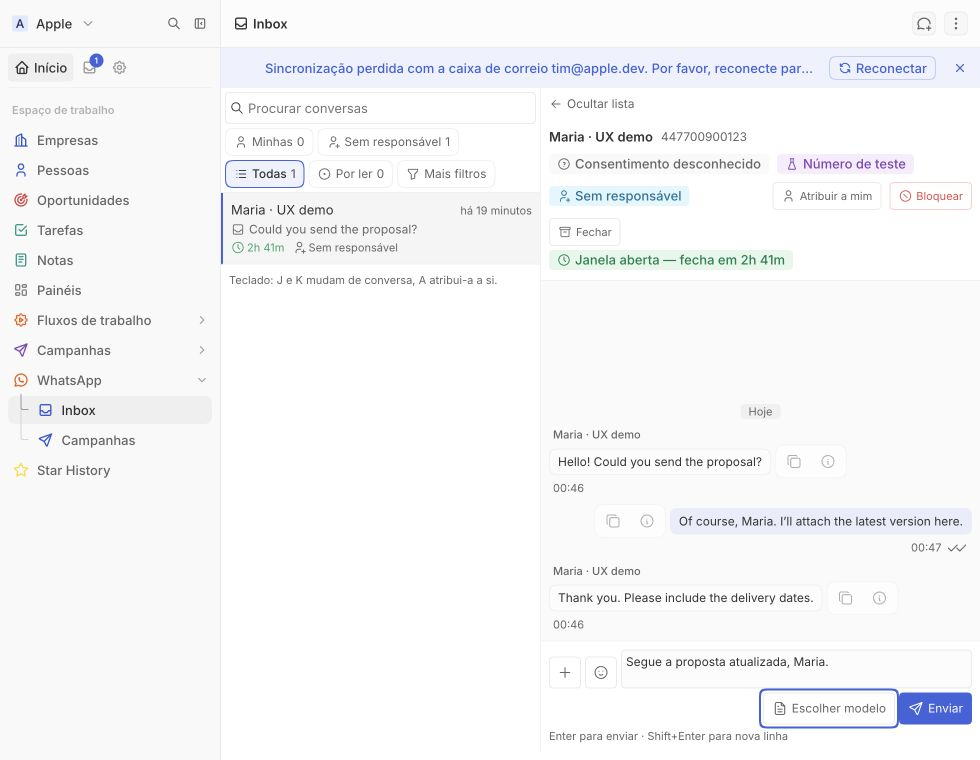

# WhatsApp extension UI/UX audit — 2026-11-03

The audit covered the shared inbox, embedded conversation, composer and send panels, template picker, campaign list/builder/detail, and settings. Existing native-upload changes were preserved. Changes remain local; production was not upgraded, deployed or published.

## Research and approach

The review combined source inspection, interaction regression tests and the actual Remote DOM sandbox in Twenty 2.54.0. Guidance came from primary sources:

- [Twenty front-component documentation](https://docs.twenty.com/developers/extend/apps/layout/front-components): use host UI APIs and account for the partial DOM; avoid assuming normal measurement, portal or scroll APIs work.
- [W3C reflow guidance](https://www.w3.org/WAI/WCAG22/Understanding/reflow.html): preserve controls and readable content as the available width changes.
- [W3C contrast guidance](https://www.w3.org/WAI/WCAG22/Understanding/contrast-minimum.html): ordinary text needs at least 4.5:1 contrast, subject to the documented exceptions.
- [W3C labels and instructions](https://www.w3.org/WAI/WCAG22/Understanding/labels-or-instructions.html): identify required input and relevant format restrictions.
- [W3C status-message guidance](https://www.w3.org/WAI/WCAG21/Understanding/status-messages): announce progress, results and errors without requiring focus to move.
- [ARIA disclosure pattern](https://www.w3.org/WAI/ARIA/apg/patterns/disclosure/): ordinary buttons with expanded state suit these inline panels. A menu role would promise additional keyboard behavior the attachment picker did not implement.
- [React Testing Library](https://testing-library.com/docs/react-testing-library/intro/): regression tests operate through rendered controls and accessible names.

The direction is incremental: keep Twenty's components and theme, make failures recoverable, retain drafts until acceptance, and keep the next action visible.

## Findings and implemented fixes

| Priority | Gap or bug | Implemented result |
|---|---|---|
| High | The inbox reserved only 52px for host chrome; Send ended 36px below an 850px viewport. Mobile scaling enlarged viewport-based sizing again. | Dynamic viewport sizing reserves host chrome and accounts for Twenty's zoom token. Embedded minimum/maximum heights also account for scaling. |
| High | Composer actions squeezed the textarea and overflowed narrow panes. | Narrow layouts give the input its own row beside the attachment/emoji buttons, with template/send actions grouped below. |
| High | Text cleared and template/media/voice/location/contact forms closed before the server accepted the send. | All send callbacks report acceptance. Refusals preserve the form, caption and selected upload. Text typed while an earlier request is pending survives its acceptance. |
| High | Repeated clicks could race React's sending state. Some local submission guards never released after refusal. | Synchronous guards protect message submissions, campaign writes and administration actions; recoverable failures release them. |
| High | Enter during IME composition could send incomplete text. | Composing Enter is ignored; ordinary Enter sends and Shift+Enter inserts a line. The shortcut is described beside the composer. |
| High | Closing or blocking a thread ignored route failures. | Failures remain visible, actions show a pending state, duplicate operations are guarded, and deliberate retry remains available. |
| High | A previous feed request could delay a new filter and clear its loading state. A refresh during a request was lost. | Requests are scoped to a generation, obsolete results/cleanup are ignored, subject errors reset, and explicit refreshes are queued. |
| High | Campaign detail failures could remain on Loading indefinitely. Failed preflight had no retry. | Detail provides Back and Retry; preflight errors have Retry and Launch stays unavailable until a successful preflight. Relevant campaign revisions refresh preflight and acknowledgement state. |
| High | Campaign search responses could arrive out of order and show the wrong contacts. | Debounced requests discard obsolete responses and clear old results. Failures are distinct from no matches and have Retry. |
| High | Reopened schedules sliced UTC text into a browser-local input. Clearing the input did not clear the stored schedule. | Stored instants convert to browser-local time; clearing persists null. Invalid/past dates have a field-associated error. |
| Medium | Inbox J/K/arrows/A shortcuts also acted inside conversation controls. | Shortcuts ignore conversation content, editable controls, modified keys and handled events. |
| Medium | Collapsing More filters hid the currently selected secondary filter. | The active filter stays visible. Conversation accessible names include unread counts and preview context. |
| Medium | Recent files iterated oldest first and could duplicate files with refreshed signatures. | Newest files appear first; reuse is deduplicated by file ID or stable unsigned address. |
| Medium | Delivery ticks used arithmetic on CSS-variable icon sizes, producing a zero-width box and clipped icons. | Ticks participate in normal flow; glyph overlap no longer depends on numeric theme tokens. |
| Medium | Location/contact panel actions scrolled away; a first-conversation template picker lacked a bounded flexible body. | Small forms keep their footer outside the scrolling fields; first-template content fits the available area. |
| High | The campaign builder could open before bootstrap finished, permanently initializing its account/template state as empty. | New/Edit wait for source data; a failed bootstrap exposes Retry. |
| Medium | Campaign users lacked an explicit way to save the current wizard step and leave. Back/Cancel could race a save. | Save draft persists current fields and media mapping together. Controls are disabled during writes and the footer wraps on narrow screens. |
| Medium | Audience-option and preview failures looked like empty data. | Separate, actionable errors with Retry replace misleading empty results. |
| Medium | Campaign responsive switching depended on delayed JavaScript measurement, and a nine-column table was offered too early. | Container queries switch immediately between cards and the table at the pane's width. The hidden presentation is removed from the accessibility tree. |
| Medium | Field hints/errors were not programmatically associated with their controls; custom inputs suppressed focus outlines. | Stable IDs connect labels, descriptions and errors, invalid controls expose their state, and scoped visible focus outlines apply across the app. Danger banners announce alerts. |
| Medium | Small supporting text used insufficient-contrast theme colors. | Supporting text uses the secondary foreground. On measured dark primary/secondary surfaces, contrast rises from roughly 3.0–3.1:1 for the old light token to 8.2–8.6:1. Hierarchy remains in size, weight and spacing. |
| Medium | Upload restrictions were discovered only after selection, and failed selections lost their filename summary. | Type/size guidance appears before choosing, the pending/failed filename remains visible, native accept filters use supported MIME types, and a broken image preview does not remove the file summary. |
| Medium | Settings could enable actions while concurrent reads remained pending, duplicate mutations, or strand the user after an initial permission-check failure. Copy had no feedback. | Pending requests are counted, mutations are guarded, the initial diagnostics check can be retried, and copy reports success/failure. |
| Medium | A late successful send could close a newly opened panel. | Panel generations prevent an obsolete completion from dismissing a later form. |
| Low | Progress and empty/loading states could be ambiguous; motions ignored reduced-motion preferences. | Initial thread loading precedes permission-dependent controls, the transcript exposes loading state, and app transitions honor reduced motion. |

## Validation

Final results:

| Check | Result |
|---|---|
| Lint | Passed; 0 warnings/errors across 321 files |
| Typecheck | Passed, including the client regenerated from the disposable 2.54 workspace |
| Unit tests | 85 files, 1,896 tests passed; repeated under Node 24.22.2 |
| Integration tests | 5 files, 41 tests passed against Twenty 2.54.0 |
| App build | Passed with the 2.54 CLI under Node 24.22.2 |
| Whitespace checks | `git diff --check` passed |

The test DOM is jsdom 26, compatible with the project's declared Node 24.5+ baseline. The newer jsdom 30 requires a higher Node minimum, so it was not retained.

### Automated coverage

24 rendered UI/hook regression tests cover refused text/template sends, retained drafts, duplicate clicks, typing during a request, IME Enter, disclosure Escape, stale/queued feed requests, field descriptions/errors, upload retry, local schedule round trips and clearing, campaign duplicate saves, stale audience search, inbox shortcut isolation, selected filter visibility, thread action failures, campaign detail recovery, explicit draft save, settings permission-check retry, preflight retry, bootstrap readiness, and host-wrapped field controls. Five additional route tests cover unfinished drafts, explicit audience removal, rejection of malformed/missing audiences at build time, and Agent write denial. A real API integration test verifies retained draft state and audience/schedule clearing.

### Browser evidence

An isolated official Twenty 2.54.0 container was used with fabricated conversation data and no Meta credentials. Testing used Microsoft Edge, real native file selection and the actual sandboxed extension.

- Narrow 439px conversation pane: input/actions reflow, keyboard focus is visible, supporting text is readable, and transcript rows have matching scroll/client widths after the delivery-tick fix.
- Short mobile layout at 620 × 600: the host's 1.07692 scaling is accounted for and attachment actions remain reachable.
- Native document upload: upload indicator, filename/size, caption, enabled Send after success, and Escape dismissal of attachment actions.
- English and Portuguese, dark and light themes, campaign editing and responsive list behavior were inspected.
- Campaign field labels and descriptions were verified in the actual host DOM, including wrapped native controls. Schedule input events update validation immediately in the sandbox.
- Save draft succeeded with an unfinished audience; reopening displayed the same 14:30 local schedule. No launch was performed.
- At a 980px viewport the campaign table is hidden and cards are visible; changing to 1360px reverses those displays immediately without a poll.

The browser viewport was restored and the QA tab closed. Fixtures were removed before the integration suite, which uninstalled the app afterward. The disposable container, temporary credentials and log watcher were removed after validation.

## Scope and release checks

No WhatsApp message or campaign was sent or launched. Real WhatsApp delivery and physical microphone capture remain release checks from the native-upload work. This is a targeted accessibility review, not a full WCAG conformance certification or an assistive-technology certification. Ordinary Agent authorization remains covered by automated checks; browser QA used the disposable administrator.
